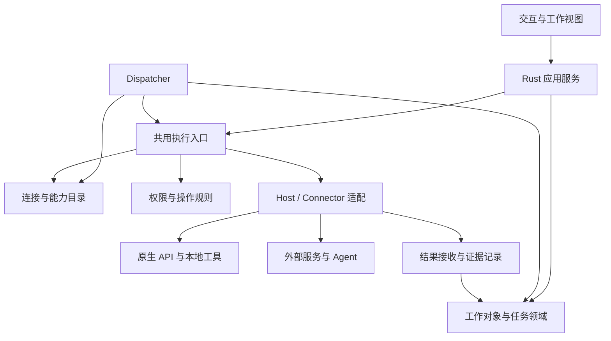

# WEXPC 轻量宿主架构细化 V0.1

- 日期：2026-10-26；起点：main `3245a47cf1fc693046ae9d2749dbec8b31cc8bda`。
- 状态：**架构细化设计稿 / 待审阅**。用户已授权在现有方向上细化；本文中的具体关系、消息字段和恢复安排是工程建议，不冒充已冻结接口或实现。
- 权威依据：[PC 基线](../PC-PRODUCT-AND-TECH-BASELINE.md) §2、§4.2～4.3、§5；[架构决策](../../DECISIONS.md)。本文解释如何落实，不新增版本承诺；产品仍为 0.1.1。
- 本轮只写架构与接口语义，不改代码，不引入新运行平台。DSH 的具体发送、会话定位和查询能力未实测。

## 1. 目标与方案选择

WEX 组织工作、连接能力、推进自己负责的流转并收回成果。Space → 可选 Group → Context 保留；API、GitHub、本地工具和外部 Agent 均进入连接体系。WEX 自有基础能力独立可用，成熟外部能力可优先复用。

| 路径 | 代价 | 处理 |
| --- | --- | --- |
| 继续在聊天 Host 中追加所有连接分支 | 非聊天来源和外部委托不断增加特例 | 不作为长期结构 |
| 先建设完整插件平台并接管外部 Agent | 引入不必要的运行时、内部状态同步和生态兼容工作 | 不作为当前前置 |
| 在现有 Core/服务/Host 上明确对象与交接，逐条接入能力 | 需要迁移现有身份和调用边界，但可保留成熟实现 | 沿用用户确认的轻量方向；以下具体拆分是本稿建议 |

职责模块是逻辑边界，不要求一模块一个 crate、进程、数据库或网络服务。首版可在现有桌面进程内运行。未来远端、插件市场、完整工作流编辑器和体系适配库不因本文启动。

## 2. 逻辑结构与依赖

图为职责依赖，不是每个请求都必须依次经过所有节点。普通对话的直接工具调用可以不进入 Task 队列；等待、依赖和持续任务才由 Dispatcher 编排。界面事件只是通知，刷新后读取权威状态。

| 组件 | 输入与输出 | 唯一负责 | 不负责 |
| --- | --- | --- | --- |
| 工作对象服务 | 对象编辑、引用、修订 → 保存后的对象 | Context/Project/Conversation 等身份与关系 | 通过目录关联授予权限 |
| Task 领域服务 | 发布、指派、结果关联、核验 → 任务版本与状态 | 正式任务事实及状态变更规则 | 重复执行外部操作 |
| 连接目录 | 配置与启停 → 连接实例、可用能力候选 | 目标解析、配置修订及能力查询 | 任务排队和模型规划 |
| Dispatcher | 已发布工作、事件、明确规则 → 领取/等待/交接请求 | WEX 一侧队列、依赖、资源协调和续接 | 技术方案判断、外部内部调度 |
| 应用执行服务 | 调用请求 → 操作身份、结果或未决事实 | 共用准入、权限协调、意图登记、适配器选择与结算 | 第二套 Task 状态、插件引擎 |
| Host / Adapter | 已核对请求及凭证引用 → 实际外部事实 | 平台/协议执行、最终适用权限检查、错误转换 | 宣布整个任务完成 |
| 验证入口 | 成果及指定版本 → 检查记录 | 记录工具、Agent 或人工检查来源及结论 | 把模型自述当工具证据 |

Core 提供平台无关规则；应用服务组织事务；Host 管凭证和实际 OS 能力。API 协议核只处理模型请求/响应，不自行执行模型提出的工具。外部适配器不直接修改 Task 正式状态。

## 3. 核心对象与关联

以下是概念字段，不是数据库表定义。同一数据可由现有结构承载，不为每个概念新建服务。

| 对象 | 需要区分的身份/信息 | 关系与生命周期建议 |
| --- | --- | --- |
| Space / Group | 稳定 ID、名称、组织位置 | Group 可选；类别不是账号或授权域 |
| Context | ID、工作背景、目标、对象引用 | 组织入口可引用会话、任务、连接及资源；移动不改变这些对象身份 |
| Project | ID、项目目标、基准、资源引用 | 软件开发等工作的持久容器；与 Context 的具体多重关联深度后续定，不强迫所有 Context 建 Project |
| Conversation | ID、消息与生成记录、当前模型配置 | 原生普通会话可独立存在；换模型保留历史来源，已开始生成绑定启动时配置 |
| Agent / Duty / Persona | 执行身份、职责绑定、交互配置 | 相同模型不等于相同 Agent；兼任职责不合并授权 |
| Connection | ID、适配器引用、配置修订、凭证引用、启停 | AI 专用模型配置不再代表所有连接必填内容；启用不等于已认证或获权 |
| Capability | 所属连接、能力标识与版本、输入输出及支持行为 | 能力可见是提示；执行时重新检查当前可用性与权限 |
| ExternalSessionRef | 连接 ID、外部会话定位、可用查询入口 | 由外部保存会话；WEX 仅保存定位，不强造原生 Conversation |
| Task / Assignment | 目标、范围、验收、任务修订、指派代次 | Task 可由多项分工完成；每项实际尝试绑定具体受派者，不把多人名单当作已派工 |
| ExecutionAttempt | 本次尝试 ID、任务/指派版本、目标、执行路径 | 原生或外部路径分别处理；重复查询不是新执行尝试 |
| Operation | 操作 ID、attempt 引用、请求内容绑定与结果 | 原生尝试可有多次工具操作；外部尝试仅记录 WEX 自己的投递/查询/收取操作 |
| ArtifactRef / Evidence / Verification | 成果位置与版本、来源、检查范围与结论 | 收到文件不等于合格；不同次产出和核验不能互相覆盖 |

Context 的工作资料与模型一次请求的上下文不同：前者长期组织，后者按本次权限和需要选取。模型可用摘要，但摘要不成为正式状态或授权来源。

**关系处理建议：**取消引用仅解除关联；归档保留历史；删除真实外部资源属于独立操作。引用失效保留其来源并显示不可访问，不静默改指向同名新对象。删除/归档正在被执行引用的对象，应先处理在途工作或保留可追溯的历史快照；具体 UI 仍待设计。授权独立撤销，不能由 Context 移动或模型切换自动继承。

## 4. 状态权威与保存

| 信息 | 权威写入口 | 其他模块的使用方式 |
| --- | --- | --- |
| 组织关系、会话配置 | 对象应用/领域服务 | UI 读投影并提交带修订的变更 |
| Task 目标/版本/指派/正式状态 | Task 领域服务 | Dispatcher 提交命令，不另存冲突状态 |
| 队列项、领取记录、尝试与唤醒条件 | Dispatcher 对应持久仓储 | 关联 Task 修订，表达投递过程而非另一个任务结果 |
| 连接配置、启停、能力观察 | 连接管理入口 | 目录查询不执行任务；观察值带来源/时间 |
| 操作事实与成果证据 | 执行/结果服务 | 模型不能写成可信工具成功 |
| 外部会话内部状态 | 外部客户端 | WEX 记录“何时观察到了什么”，不宣称全知 |
| 长期摘要/记忆 | 受控记忆写入口 | 引用基准和证据，不覆盖其原始事实 |

建议沿用 SQLite 及现有不可变回执，而非另建总事件平台。一次本地事务只原子修改本地记录；不能把数据库事务覆盖到网络或外部文件写入。

副作用前持久记录请求身份与投递意图，再执行外部调用，之后保存观察结果并通过可去重的关联更新任务。执行期间不持有长数据库锁。若外部已执行而记录失败，恢复时保留不确定状态，先查询或核对成果；不能因数据库中没有成功记录就重发。

回执文件与数据库若不在同一事务中，需定义发布顺序、校验和恢复关联。建议先保存不可变证据再更新索引，失败可补索引；没有证据不能补造成功。最终存储格式、原子发布方法及断电保证留给专项实现和平台验证。

## 5. 连接与能力交接语义

一项连接可有生成、读取、修改、委派、查询等多种能力。同类能力也可由不同连接提供。连接对象、接入机制和用途分别记录，不用单一互斥枚举限制。

| 语义入口（名称仅示意） | 最少输入 | 输出及关键边界 |
| --- | --- | --- |
| 查询能力 | 当前主体、可选范围、能力用途 | 候选连接/能力与可用性观察；不产生执行许可 |
| 提交调用 | 主体、连接/能力、配置修订、输入、来源关联 | 操作身份与即时结果或待查询引用 |
| 投递委托 | 上述信息、具体外部会话、工作说明、成果约定、attempt | 明确拒绝、确认接收或投递不确定；不臆造接收证明 |
| 查询/收取 | 已有 attempt、外部定位、读取授权 | 外部观察、成果引用、尚未取得或不支持 |
| 取消 | 具体 attempt/operation、适用权限 | 已请求、确认停止、不支持或未知；不承诺副作用回滚 |
| 记录核验 | 具体成果版本、检查来源/范围、结果 | 不可混同的 Review/Verify 记录与任务变更依据 |

共同关联建议包含：request/operation/attempt ID、actor、connection/capability、配置修订、可选 Context/Conversation/Task 及其修订、输入绑定、允许的资源和执行策略引用。凭证值不进入这些公共记录。普通非任务调用允许没有 Task，非聊天调用允许没有 Conversation。

外部接收回执可以是外部任务 ID、可查询记录或适配器实际观察到的确认；仅启动进程或发起网络请求不足以证明对方接收。平台不支持可靠查询时如实显示不确定，可由用户或可信查询补充核对。

连接配置改变不把在途请求悄悄转向新账号、地址或会话；历史尝试保留原引用。撤权阻止后续新调用；对在途操作仅能按实际能力取消/观察。查询和成果读取也要检查当前权限，不能为了恢复绕过撤权。

## 6. 四条运行链

### 6.1 普通对话或直接工具调用

用户/UI 或模型提出请求 → 应用执行服务解析连接与能力 → 按当前策略授权并登记 → Host/Adapter 执行 → 保存结果 → 返回原调用者。模型需要续答时将已结算结果交给对应原生会话；不创建强制 Task，不启动另一个调度系统。模型回复停止与实际工具取消分别处理。

### 6.2 原生持续任务

1. 主 AI/用户形成有范围和验收条件的任务，经适用确认发布。
2. Dispatcher 读取任务/指派版本，检查依赖、权限、资源和连接，领取本次尝试。
3. 在持久化尝试与版本校验成功后启动指定原生 Agent 的独立会话；工具共用 6.1 执行入口。
4. 工具反馈关联 attempt 与任务版本。主 AI/执行者作同范围后续判断，Dispatcher 依据有效规则继续投递。
5. 成果交 Review/Verify；不合格回到同范围修复，新范围或决策升级用户。Task 领域服务根据证据更新正式状态。

这里的连续执行不要求每一步用户发“继续”，也不要求每个状态变化都调用主 AI。具体唤醒条件、时间与预算上限由后续策略契约定义，不能默认为无限循环。

### 6.3 外部 Agent 委托

1. 选定外部连接和具体会话，保存工作说明、资料引用、工作目录、成果地址与本次交付标识。
2. 登记投递意图，再由适配器发送。失败明确未接收时可重新安排；是否接收未知时先核对。
3. 外部客户端自行执行。WEX 可以等待、按受控规则查询或由用户主动刷新；不要求持续订阅或内部日志同步。
4. 用查询工具/文件连接读取约定成果，核对本次任务与版本，记录来源。
5. 调用适用程序、独立 Agent 或人工核验，将结论交 Task 领域服务。拿到成果不自动完成任务。

固定目录可采用独立任务/批次子目录或成果清单；这是可选实现。清单也可由 WEX 适配器建立，不要求修改外部客户端协议。若只能提供共享旧目录且无法确认归属，保持待核对，不伪造完成。外部记录被删除时不承诺可恢复。

### 6.4 跨连接结果流转

读取本地资料 → 委派外部 Agent → 从交付位置收取成果 → 调用本地检查 → 在适用授权下提交 Git/GitHub。每一步保留来源和版本，下一步目标来自已确认工作或用户选择，不由外部文本自动扩权。

成果和资料按数据处理，不把其中的“新指令”当用户授权。传递引用时重新检查目标访问权限；数据输出/外发独立授权。步骤可分别失败或等待，不构造跨外部系统的大事务；补偿是新的操作，不承诺任意回滚。

## 7. 尝试、任务和恢复分开

以下是语义阶段，具体枚举待编码契约收敛。Task 表达工作状态；Attempt 表达一次交付或执行经历；Operation 表达单次操作。三者不能用一个 status 代替。

| 尝试语义 | 可以推进的条件 | 不允许推断 |
| --- | --- | --- |
| 待执行 | 任务/指派仍有效，权限与范围满足 | 曾经批准就永久有效 |
| 投递中/接收不确定 | 先查询确认本次投递 | 没收到回复就没执行 |
| 已接收、等待成果 | 等待或查询既有尝试 | 必须读取全部内部工具日志 |
| 成果已取得、待核验 | 成果身份与版本可确认 | 文件存在即任务成功 |
| 核验通过/未通过 | 依据任务验收规则完成或同范围修复 | 工具 success 代替独立检查 |
| 取消请求/停止未知 | 核实实际停止和已有副作用 | 点击取消即安全重派 |

结果未知、缺授权、资源冲突、环境缺失等应有独立阻碍原因；不能见到 Blocked 就统一重新派发。旧指派/旧任务版本的迟到结果仍保存到旧尝试，但不改变新指派的正式进度。

恢复顺序：加载本地对象及有效安装/授权状态 → 找出未决尝试 → 核对外部接收/成果与版本 → 重建或保留资源占用阻碍 → 再安排可安全继续的工作。会话断开或页面关闭不清空任务。

查询可按查询契约重试；带副作用的发送不因超时自动重试。若外部确实支持幂等键，可对同一投递身份按其已验证语义处理；不得假定所有连接支持。外部不可用可以选择原生路径，但切换前先核对已执行内容和占用，创建关联的新尝试，不改写旧历史。

正常应用重启与卸载/系统重装分开：后者不从旧资料自动恢复有效凭证与许可。保留资料只能恢复事实，不等于恢复授权。

## 8. 并发与安全保证

| 情况 | 建议采用的控制 | 可以声称的保证 |
| --- | --- | --- |
| WEX 受控文件调用 | 规范资源身份、父子范围冲突、版本与权限复检 | 对经过受控入口的冲突进行阻止 |
| 通用终端/原生 Agent 运行任意程序 | 明确进程实际权限及工作区策略 | 工作目录与文件工具许可不等于限制进程全盘访问 |
| 外部 Agent 独立工作区 | 分离工作树/交付区，集成前核对共同基准及冲突 | 工作区分离降低覆盖冲突，不自动形成 OS 隔离 |
| 外部共享写区 | 已验证的外部协调机制；否则不并发委派重叠范围 | 仅保证 WEX 自己不重复发出冲突委托，不保证无第三方写入 |
| 不同任务共用 Git 索引或构建输出 | 将实际共享输出/仓库元数据计入协调范围，或隔离执行 | 文件名不重叠不必然等于资源不冲突 |
| 外部执行是否停止未知 | 保留占用/阻碍直至核对，不能只因本地 lease 释放而重派 | 不将本地锁消失误当作外部已停止 |

独立工作区、外部协调和实际沙箱各自证明不同性质。本文不选定沙箱产品，也不声称 WEX 可阻止外部所有操作。产品界面应显示实际执行位置与控制限制，不把“已授权目录”标成未经验证的隔离环境。

## 9. 与当前代码的落点

以下是职责映射建议，不是代码已实现证明；施工前须针对最新目标 SHA 检查调用者。

| 现有位置 | 建议保留/调整方向 |
| --- | --- |
| wex-core 的权限、Operation、Task、dispatch、lease | 保留规则；Task/Attempt/Operation 关系与真实资源协调需接线 |
| wex-desktop-service 的 domain/application/infrastructure | 承接对象、连接及任务应用服务，定义桌面任务与 Core 的唯一映射，避免两套状态 |
| wex-api | 保留协议核；工具意图由应用服务处理 |
| src-tauri 的 tool_approvals / local_access / github_config | 保留平台执行、凭证及安全机制；逐步把通用目录和编排职责移出 |
| PR #75 的 tool_catalog | 作为模型可见目录的抽离起点；不当作完整连接注册或插件系统 |
| 不可变回执、检查点与 SQLite | 明确事务和恢复关联，保留已有安全发布机制 |
| React 及未来其他视图 | 读同一对象与结果投影，不保存第二套权威任务/权限 |

旧 AI 连接身份与凭证引用应保留；GitHub/本地来源迁移到通用目录时不凭历史固定字符串猜账号身份。迁移范围包括会话、任务、日志、检查点和授权引用；不能只给新字段默认值就宣称兼容。先选定源码起点，再设计迁移与失败回退，不在本稿分配 schema 版本。

## 10. 后续细化顺序与设计验收

这是设计依赖顺序，不替换现有 P1～P6，也不取消任何首版目标。

| 下一项 | 必须交付的具体内容 | 完成前不能声称 |
| --- | --- | --- |
| A 对象与版本契约 | Task/分工/Attempt/Operation 的映射、所有权、变更与迟到结果规则 | 桌面任务已与执行闭环 |
| B 连接调用契约 | 通用连接与专用配置、能力支持、原生调用输入输出、失效处理 | 已实现动态插件生态 |
| C 外部交接实验 | 对指定客户端/会话真实投递、查询、成果收取、错误与未知行为 | DSH 已接入或能精确取消 |
| D 持久化与并发契约 | 事务边界、去重、证据补关联、资源控制及恢复 | 崩溃安全或外部隔离已验证 |
| E 纵向集成 | 普通调用、持续任务、独立检查、重启接续 | 只有类型定义就完成 0.1.1 |

设计检查用例（本轮仅审查，运行均未执行）：
1. 无 Task 的普通聊天和无 Conversation 的直接请求均能表达。
2. 两个连接提供同类能力不会串账号；一个连接可提供多类能力。
3. 同模型的两个 Agent 保持身份和授权独立；Context 移动不扩权。
4. 外部客户端保留自己的会话，仅凭投递和成果边界也能交接。
5. 投递超时后查到已接收，不二次发送；旧成果不结算新尝试。
6. 任务改派后的迟到结果进入旧记录，不改变新指派状态。
7. 原生/外部并发经过各自真实控制边界，不把内部 lease 当外部锁。
8. 外部成果到达但核验失败，任务进入修复或待决，不假报完成。
9. 成果已保存而索引失败，可恢复关联；外部成功但无可信结果则待核对。
10. 连接停用/撤权、取消不支持与应用重启分别保留真实事实。
11. 外部不可用时原生能力仍可用；结果未知不自动重复执行。
12. 全部路径均不要求先建设完整插件平台、外部历史镜像或独立守护进程。

未定项：具体函数/trait、字段上限、持久格式、队列唤醒策略、资源规范化算法、外部接口、隔离实现与 UI 删除行为。以上需要逐项收敛，不影响本稿已明确的职责和交接方向。
